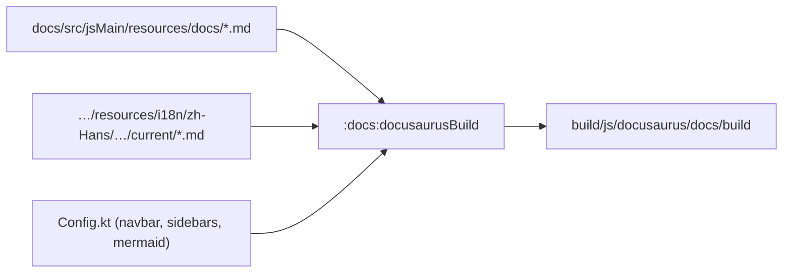

# Development

## Requirements

- JDK 17 or newer (the build uses Gradle 9.4.1).
- Node.js is downloaded by the Kotlin Gradle plugin; npm is used because Yarn is disabled in
  `gradle.properties`.
- Chromium is downloaded by Playwright the first time browser tests run.
- The demo's end-to-end test is a Playwright JUnit 5 suite that drives the bundled page, so `node` must also
  be on `PATH`.

## Commands

```bash
./gradlew build                     # everything the host can run
./gradlew :ktjs-echarts:jsBrowserTest
./gradlew :ktjs-echarts-gl:jsBrowserTest
./gradlew :demo:e2eTest             # Playwright over the bundled demo page
./gradlew :docs:docusaurusBuild     # this site
./gradlew pagesSite                 # build/pages: docs at /, demo at /demo/, Dokka at /api/
```

After adding or upgrading an npm dependency, refresh the shared lock file **before** the build that reads it:

```bash
./gradlew kotlinUpgradePackageLock
```

## Documenting



Every page has a translation in `i18n/zh-Hans/docusaurus-plugin-content-docs/current/` with the same relative
path. **Change both**: a page that exists in one language only leaves the site inconsistent. Diagrams are
mermaid fenced blocks (` ```mermaid `), not images — the theme renders them, so they follow the light/dark
switch on their own.

## Release

Releases run through `.github/workflows/release.yml`: it signs the artifacts, packages one archive per Maven
coordinate and registers them with the shared Maven Central hub, which merges the pending registrations into a
single Central deployment. A working tree is never a release: the version carries the `-SNAPSHOT` suffix unless
`-Pktjs.release=true` is passed.
