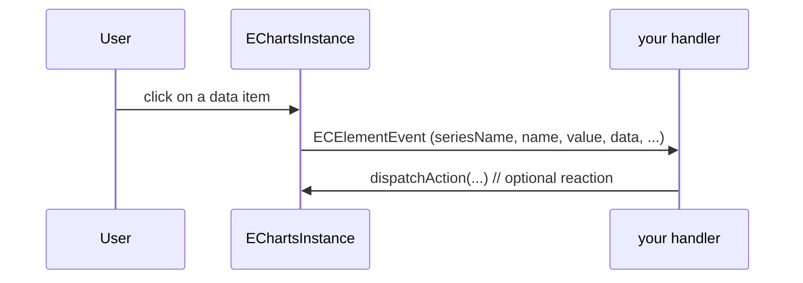

# Events

Event names are constants in `EChartsEvents`; the payloads are typed, so the fields a mouse handler reads
exist on the event interface instead of behind `Any`:

```kotlin
import io.github.shijianjs.ktjs.echarts.ECElementEvent
import io.github.shijianjs.ktjs.echarts.EChartsEvents

chart.on(EChartsEvents.Click) { event: ECElementEvent ->
    println("${event.seriesName}: ${event.name} = ${event.value}")
}
```

Four events have dedicated helpers, because their payloads differ from the mouse events:

| Helper | Fires when |
| --- | --- |
| `onSelectChanged` | the selection of a series changes (`selectchanged` payload) |
| `onAxisBreakChanged` | an axis break is toggled |
| `onFinished` | an animation of the chart finished (`finished` payload) |
| `onRendered` | a frame was rendered (`rendered` payload) |



## Dispatched actions

`dispatchAction(payload)` drives the chart from code — highlight, show tooltip, select, change data zoom.
`makeActionFromEvent(event)` turns an event payload back into the action payload of the same shape, which
is how "replay this interaction" is expressed.

## Lifecycle

`on` returns the instance, so registrations chain. `off` removes a handler, and `dispose()` tears the
instance down; a disposed instance answers `isDisposed()` with `true`. Removing the container element is not
enough — ECharts keeps its own listeners on the canvas.
