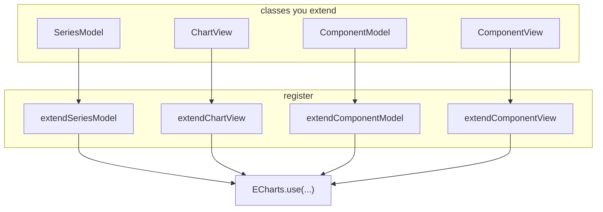

# Extension authoring

Custom series, components and views extend the classes the upstream package exposes from `echarts/core`:
`Model`, `ComponentModel`, `SeriesModel`, `ChartView`, `ComponentView`, `SeriesData`, `Axis`, `GlobalModel`
and `ExtensionAPI`. The registration helpers mirror the upstream functions: `extendComponentModel`,
`extendComponentView`, `extendSeriesModel` and `extendChartView`.

```kotlin
import io.github.shijianjs.ktjs.echarts.extendSeriesModel

val seriesModel = extendSeriesModel(js("({ type: 'mySeries' })"))
ECharts.use(seriesModel)
```



`SeriesData` is the Kotlin name of the upstream `List` class; it is mapped back to `List` at the JavaScript
boundary so it never collides with `kotlin.collections.List`.

## Registering other assets

The module-level API also carries the registrars that are not class extensions: `registerTheme`,
`registerMap`, `registerLocale`, `registerAction`, `registerCoordinateSystem`, `registerCustomSeries`,
`registerLayout`, `registerVisual` and the rest, with the same overloads as upstream. They all hang off
`ECharts` (and `EChartsCore`) and take effect for every instance created afterwards.

## Namespaces

`ECharts` and `EChartsCore` expose the upstream helper namespaces with typed members where the upstream
declarations provided enough information:

| Namespace | Examples |
| --- | --- |
| `format` | `formatTpl`, `addCommas`, `encodeHTML`, `truncateText` |
| `time` | `parse`, `format`, `roundTime`, `getTimezoneOffset` |
| `number` | `parsePercent`, `nice`, `linearMap`, `getPrecision` |
| `helper` | model and data helpers for extension authors |
| others | `graphic`, `color`, `matrix`, `vector`, `util`, `zrUtil`, `zrender`, `dataTool` |

When upstream declares a namespace member as `any`, the Kotlin side says `JsAny` and the KDoc says why —
those are the members that carry no type information in the upstream `.d.ts`.
