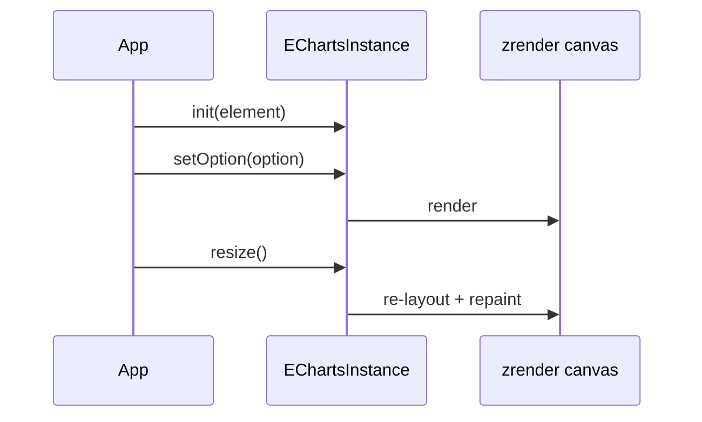

# Getting started

## Install

```kotlin
dependencies {
    implementation("io.github.shijianjs:ktjs-echarts:6.1.0-kt.1")
}
```

Replace the version with the one you need (`{upstream version}-kt.{revision}`).

## A first chart

The full bundle registers every chart and component, so it needs no installers:

```kotlin
import io.github.shijianjs.ktjs.echarts.AxisTypes
import io.github.shijianjs.ktjs.echarts.ECharts
import io.github.shijianjs.ktjs.echarts.options.EChartsOption
import io.github.shijianjs.ktjs.echarts.options.XAxisOption
import io.github.shijianjs.ktjs.echarts.options.YAxisOption
import io.github.shijianjs.ktjs.echarts.options.lineSeries
import io.github.shijianjs.ktjs.echarts.options.numbers
import io.github.shijianjs.ktjs.echarts.options.one
import js.objects.unsafeJso
import web.dom.document
import web.html.HtmlTagName

val element = document.createElement(HtmlTagName.div)
document.body.append(element)

val chart = ECharts.init(element)
chart.setOption(
    unsafeJso<EChartsOption> {
        xAxis = one(unsafeJso<XAxisOption> { type = AxisTypes.category })
        yAxis = one(unsafeJso<YAxisOption> { type = AxisTypes.value })
        series = arrayOf(lineSeries { data = numbers(120.0, 200.0, 150.0) })
    },
)
```

The container has no intrinsic size, so give the element one (`style.width` / `style.height`) or let the
chart resize to the element's box.

## Resize

ECharts does not observe its container: forward resize events yourself.

```kotlin
import web.events.EventHandler
import web.window.window

window.onresize = EventHandler { chart.resize() }
```



## Demo and tests

```bash
# Per-module browser tests
./gradlew :ktjs-echarts:jsBrowserTest

# End-to-end suite for the bundled demo (Playwright; needs node on PATH)
./gradlew :demo:e2eTest
```

The demo is the reference for how a page wires the wrapper: it loads the examples from `demo/` and runs them
against the published modules.
