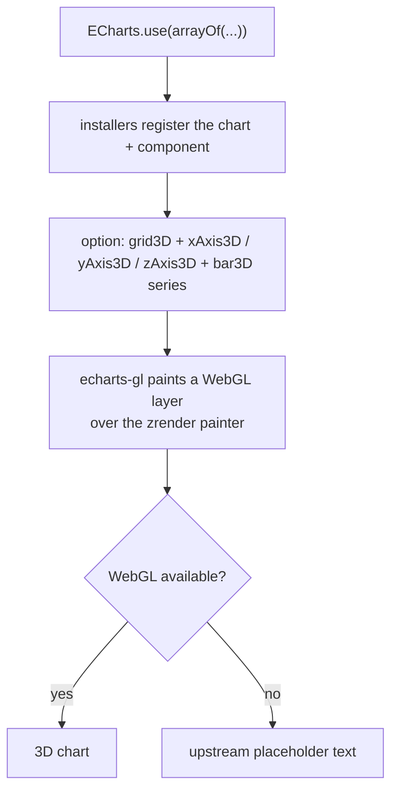

# 3D and WebGL

`ktjs-echarts-gl` wraps [`echarts-gl`](https://www.npmjs.com/package/echarts-gl) 2.1, the extension pack that
adds 3D and WebGL series to ECharts 6. `echarts-gl` ships plain JavaScript without TypeScript declarations,
so the declarations here come from the upstream source and the `option-gl` documentation rather than from a
generator.

```kotlin
dependencies {
    implementation("io.github.shijianjs:ktjs-echarts-gl:2.1.0-kt.1")
}
```

The module depends on `ktjs-echarts` with `api` scope, so the core wrapper comes along.

## Register, then draw

```kotlin
import io.github.shijianjs.ktjs.echarts.gl.Bar3DChart
import io.github.shijianjs.ktjs.echarts.gl.Grid3DComponent

ECharts.use(arrayOf(Bar3DChart, Grid3DComponent))
```

Then set `grid3D` / `xAxis3D` / `yAxis3D` / `zAxis3D` and a `bar3DSeries`. The series is drawn into a WebGL
layer above the canvas: the container needs a size, and the browser needs WebGL. Without it, `echarts-gl`
renders its "Sorry, your browser does not support WebGL" placeholder instead of the chart — no exception,
no log.



## Installers

Charts (`echarts-gl/charts`):

| Installer | `series.type` | Notes |
| --- | --- | --- |
| `Bar3DChart` | `bar3D` | bars in `grid3D`, `geo3D` or `globe` |
| `Line3DChart` | `line3D` | polylines in the same coordinate systems |
| `Scatter3DChart` | `scatter3D` | points with symbols |
| `Lines3DChart` | `lines3D` | lines between coordinates, with an optional trail effect |
| `Polygons3DChart` | `polygons3D` | extruded polygons on `geo3D` |
| `SurfaceChart` | `surface` | surface from an `[x, y, z]` grid |
| `Map3DChart` | `map3D` | regions of a registered map on `geo3D` / `mapbox3D` / `maptalks3D` |
| `ScatterGLChart` | `scatterGL` | WebGL 2D scatter for very large point sets |
| `GraphGLChart` | `graphGL` | force-directed graph laid out on the GPU |
| `FlowGLChart` | `flowGL` | particles along a vector field |
| `LinesGLChart` | `linesGL` | WebGL 2D lines for large numbers of segments |

Components (`echarts-gl/components`): `Grid3DComponent` (`grid3D` with `xAxis3D` / `yAxis3D` / `zAxis3D`),
`Geo3DComponent` (`geo3D`), `GlobeComponent` (`globe`), `Mapbox3DComponent` (`mapbox3D`) and
`Maptalks3DComponent` (`maptalks3D`). The Mapbox and maptalks variants assume the page loads those libraries
itself; `echarts-gl` only renders into their canvas.

## Options

`EChartsGlOption` extends the core `EChartsOption` with `grid3D`, `xAxis3D`, `yAxis3D` and `zAxis3D`; the GL
specific types live in `io.github.shijianjs.ktjs.echarts.gl.options`:

- `Grid3DOption` — layout, `boxWidth` / `boxHeight` / `boxDepth`, `environment`, and the nested
  `viewControl`, `light`, `postEffect` and `temporalSuperSampling` options.
- `Axis3DOption` — one type for the three axes: range, `name*`, split lines and areas, axis line, ticks,
  labels, axis pointer.
- `ViewControlOption` — projection, camera angles and distance, auto rotation, damping, mouse-button bindings.
- `LightOption` — main, ambient and ambient cubemap lights.
- `PostEffectOption` — bloom, depth of field, SSAO, SSR, FXAA, color correction, edges. The upstream aliases
  `DOF`, `SSAO`, `SSR` and `FXAA` are available as `dof`, `ssao`, `ssr`, `fxaa`.
- `ShadingOption` — `shading` plus `realisticMaterial`, `lambertMaterial`, `colorMaterial` and
  `hatchingMaterial`.
- Series options built through factories: `bar3DSeries { }`, `scatterGLSeries { }`, `linesGLSeries { }`,
  `flowGLSeries { }`, `graphGLSeries { }`, `polygons3DSeries { }`, `map3DSeries { }`. Each carries a typed
  `data` view (`typedData`, `typedItemStyle`, `typedLabel`, `typedEmphasis`, ...).

Enumerated values are typed: `CoordinateSystems2D`, `CoordinateSystems3D`, `ShadingTypes`, `GridPlaneTypes`,
`GlBlendModes`, `ProjectionTypes`, `QualityTypes`, `AutoRotateDirections`, `MouseButtons`,
`FlowGLParticleTypes`, `GraphGLFocusNodeAdjacencyOns` and `EChartsGlSeriesTypes`.

## Why the wrapper imports the core module

Every installer `import`s `echarts-gl/lib/echarts-gl.js` for its side effects: that module registers the
post-update hook which inserts the WebGL layer into the zrender painter and mounts `echarts.graphicGL`.
Upstream's `sideEffects` list only matches the files directly under `lib/chart` and `lib/component`, not the
nested installer files, so a bundler with `sideEffects` optimisation — webpack's default — drops that import
and the chart renders nothing at all.

Reading an installer therefore loads the core module through the wrapper, which keeps it in the bundle
regardless of how thin the application's own imports are. The cost is that the core module is not
tree-shakable; it is a few kilobytes next to claygl and zrender.
