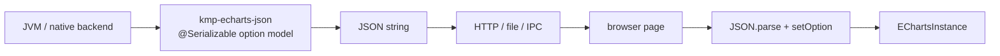

# Options as JSON

`kmp-echarts-json` models the ECharts option schema as `@Serializable` Kotlin classes. It is pure common code
— every declaration lives in `commonMain`, no JavaScript-only API is used — and it targets JVM, JS (Node.js),
Wasm/JS (Node.js), Linux x64 and Windows x64. It produces a JSON string; something else has to hand it to
`setOption`.

```kotlin
dependencies {
    implementation("io.github.shijianjs:kmp-echarts-json:6.1.0-kt.1")
}
```



Use this module when the option is built on the server or when the chart is rendered by another process. The
Kotlin/JS wrapper and this module can also be combined: the wrapper types the object handed to
`setOption`, this one types the payload that travels to it.

## Quick start

```kotlin
import io.github.shijianjs.ktjs.echarts.json.*

val option = echartsOption {
    tooltip { trigger = TooltipTrigger.Axis }
    legend { entries("Revenue", "Cost") }
    xAxis {
        type = AxisType.Category
        categories("Jan", "Feb", "Mar")
    }
    yAxis { type = AxisType.Value }
    series {
        line {
            name = "Revenue"
            values(120, 200, 150)
            smooth = BooleanOrNumber.of(true)
        }
    }
}

val json: String = option.toJsonString(prettyPrint = true)
```

## Unset stays absent

ECharts applies its defaults only to absent keys, and an explicit `null` is not the same as an omitted key.
Every model property is therefore nullable and initialized to `null`, and the shared `Json` instance uses
`encodeDefaults = false` plus `explicitNulls = false`:

```kotlin
echartsOption { }.toJsonString() // "{}"
```

Serialization is centralised in `EChartsJson`: `format` (compact), `pretty` (two-space indentation) and
`encodeToJsonElement(option)`, which returns the `JsonObject` when you want to merge or inspect.

## Typed values

Values ECharts accepts in more than one JSON shape get sealed interfaces with factory helpers, so the shape is
visible at the call site:

| ECharts value | Kotlin |
| --- | --- |
| `number \| string` (`min`, `max`, `left`, ...) | `NumberOrString`, `num(0)`, `str("dataMax")` |
| `number \| string \| number[]` (`symbolSize`) | `NumberOrStringOrNumbers`, `of(10)`, `numbers(10, 20)` |
| `boolean \| string` (`darkMode`, `roam`) | `BooleanOrString.of(...)` |
| `boolean \| number` (`smooth`, `progressive`) | `BooleanOrNumber.of(...)` |
| `boolean \| [number, number]` (`boundaryGap`) | `BoundaryGap.of(...)` |
| colors, gradients, patterns | `EChartsColor.Css`, `LinearGradient`, `RadialGradient`, `Pattern` |

`series.data` entries are `DataValue`s: numbers, strings, booleans, `null` gaps, arrays (points and rows) and
typed items. `DataItem` covers the object form with per-point styles.

`SeriesType` is a value class, not an enum, so third-party series such as the `echarts-gl` 3D types are
emitted as well:

```kotlin
series {
    add(SeriesType("scatter3D")) {
        name = "3D points"
        coordinateSystem = "geo3D"
    }
}
```

`SeriesOption` is one flat class carrying the optional fields of every series family. ECharts ignores fields
that do not apply to the selected `type`, and a single class keeps the model maintainable while still
type-checking every value.

## Time values

The module is multiplatform, so date and time values are converted explicitly. A `time` axis accepts epoch
milliseconds or the string forms ECharts parses:

```kotlin
DataValue.InstantValue(Instant.fromEpochMilliseconds(1_700_000_000_000)) // epoch ms
LocalDateTime.parse("2024-04-05T06:07:08").asDataValue() // "2024-04-05 06:07:08"
LocalDate.parse("2024-04-05").asDataValue()              // "2024-04-05"
```

## Escape hatch

For options the module does not model yet, `JsonElement` helpers merge raw JSON into the result: `extra` for
top-level keys (applied after the typed ones, so it wins on conflicts), and `with(key, value)`, `plus`,
`deepMerge`, `toJsonElement()`, `prettyPrint()` and `toEChartsJsonString(...)` for anything nested.

## Tests

```bash
./gradlew :kmp-echarts-json:build          # every target this host can run
./gradlew :kmp-echarts-json:jvmTest
./gradlew :kmp-echarts-json:jsNodeTest
./gradlew :kmp-echarts-json:wasmJsNodeTest
./gradlew :kmp-echarts-json:mingwX64Test
```

The suite lives in `src/commonTest` and runs unchanged on every target.
