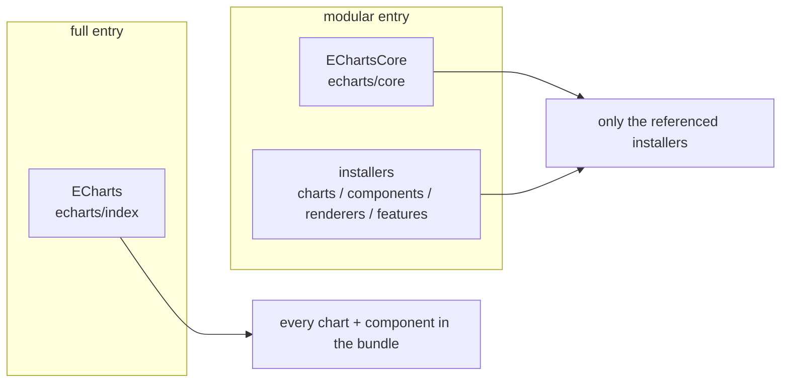

# Modular builds

`EChartsCore` is the `echarts/core` entry point. Register only the charts, components, renderers and
features the page uses, then initialize through `EChartsCore`:

```kotlin
import io.github.shijianjs.ktjs.echarts.EChartsCharts
import io.github.shijianjs.ktjs.echarts.EChartsComponents
import io.github.shijianjs.ktjs.echarts.EChartsCore
import io.github.shijianjs.ktjs.echarts.EChartsRenderers

EChartsCore.use(
    arrayOf(
        EChartsCharts.LineChart,
        EChartsComponents.GridComponent,
        EChartsComponents.TooltipComponent,
        EChartsRenderers.SVGRenderer,
    ),
)

val chart = EChartsCore.init(element)
```

Installers are properties on four objects: `EChartsCharts`, `EChartsComponents`, `EChartsRenderers` and
`EChartsFeatures`. The renderer is an init option:

```kotlin
val chart = EChartsCore.init(
    element,
    null,
    unsafeJso<EChartsInitOpts> { renderer = RendererTypes.svg },
)
```

## What stays modular

Whether the bundle stays modular depends only on what you reference:



`EChartsCore` and the full `ECharts` entry are separate `@JsModule` declarations, so using only the former
does not pull in the full build. A single reference to `ECharts` anywhere in the bundle does — so on the
modular path, use `EChartsCore` for registration *and* for the helper namespaces.

Both entries create an `EChartsInstance`, so an instance created through `EChartsCore` can be passed to any
helper that expects that shared type.

## Interaction with echarts-gl

`ktjs-echarts-gl` depends on the full `echarts` build internally (see [3D and WebGL](gl.md) for why), so a
page that draws GL series cannot also claim a modular bundle. Pick one: GL series, or a hand-picked installer
list.
