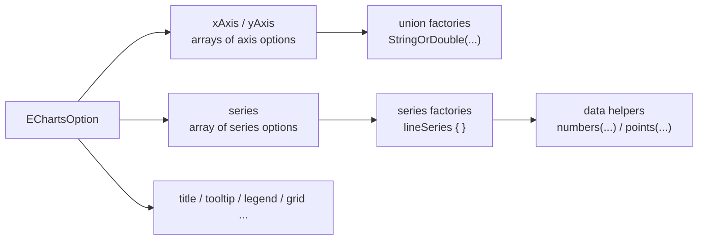

# Options

An option is a plain JavaScript object, so it is modeled as `external interface` types with nullable `var`
properties. Build it with `js.objects.unsafeJso<T> { ... }` from kotlin-js-plain-objects, which creates a
real object literal and applies the receiver block. Properties you leave untouched keep the ECharts
default — assigning `null` writes a real `null` instead.

```kotlin
val title = unsafeJso<TitleOption> {
    text = "Monthly revenue"
    subtext = "In thousands"
}
```

## Typed values instead of strings

Upstream declares a lot of string enumerations. Here each one is a `sealed external interface` with a
constant object, so a typo is a compile error rather than an option ECharts silently ignores:

| Constant object | Covers |
| --- | --- |
| `AxisTypes` | `category`, `value`, `time`, `log` |
| `SeriesTypes` | every bundled series type, including GL ones |
| `TooltipTriggers` | `item`, `axis`, `none` |
| `LegendTypes` | `plain`, `scroll` |
| `AxisPointerTypes` | `line`, `shadow`, `cross`, `none` |
| `ImageTypes` | `png`, `jpeg`, `svg` |
| `AnimationEasings` | the easing names |
| `RendererTypes` (`io.github.shijianjs.ktjs.zrender`) | `canvas`, `svg` |

Fields that take a CSS value use the kotlin-wrappers types — `web.cssom.FontStyle`, `FontWeight`,
`TextAlign`, `VerticalAlign` — and the canvas line cap / join types.

## Unions

Where upstream writes `A | B`, the wrapper uses an opaque interface plus same-name factories. The explicit
wrapper is what keeps the union typed instead of falling back to `dynamic`:

```kotlin
StringOrDouble("40%")     // string branch
StringOrDouble(24.0)      // number branch
BooleanOrDouble(true)
DoubleOrDoubleArray(arrayOf(4.0, 8.0))
```

## Helpers

`io.github.shijianjs.ktjs.echarts.options` holds the helpers that make an option readable:

| Helper | Why it exists |
| --- | --- |
| `one(value)` | Fields that accept both one component and a list are typed as arrays; `one` wraps the common single-component case. |
| `numbers(...)`, `points(...)`, `items(...)` | Build series data as real JavaScript arrays. A Kotlin `DoubleArray` is a *typed* array, which ECharts rejects as series data. |
| `lineSeries { }`, `barSeries { }`, `pieSeries { }`, ... | Create a series object with the matching `type` already set. |
| `linearGradient(...)`, `radialGradient(...)`, `gradientColorStop(...)` | Color gradients, with stops as typed entries. |



## Series data

`series.data` accepts numbers, points, rows and typed items. `numbers(...)`, `points(...)` and `items(...)`
cover the three common shapes; anything else is an `unsafeJso` item of the matching data-item type.
