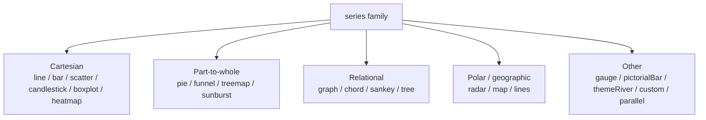

# Series and charts

Every series family bundled with ECharts has a factory that sets `type` for you. The factory's receiver is
the series option type, so its fields are the ones upstream declares for that family:

```kotlin
series = arrayOf(
    lineSeries {
        name = "Revenue"
        smooth = BooleanOrDouble(true)
        data = numbers(120.0, 200.0, 150.0)
    },
    barSeries {
        name = "Cost"
        data = numbers(90.0, 140.0, 130.0)
    },
)
```

`line`, `bar`, `pie`, `scatter`, `effectScatter`, `radar`, `map`, `tree`, `treemap`, `sunburst`, `graph`,
`chord`, `funnel`, `gauge`, `pictorialBar`, `themeRiver`, `custom`, `boxplot`, `candlestick`, `heatmap`,
`parallel`, `lines` and `sankey` are covered. The 3D and WebGL families live in `ktjs-echarts-gl` and
follow the same shape (`bar3DSeries`, `scatterGLSeries`, ...).



## Which coordinate system

The series type does not decide the layout: `xAxis` / `yAxis` decide whether a line chart is Cartesian,
`polar` + `angleAxis` / `radiusAxis` make it polar, and `calendar` / `singleAxis` / `geo` are separate
coordinate systems. A series that names a `coordinateSystem` it cannot use simply does not render, and
ECharts reports nothing in the console — so when a chart is blank, check the coordinate system before the
data.

## Data shapes

| Shape | Helper | Upstream type |
| --- | --- | --- |
| `[120, 200, 150]` | `numbers(...)` | `Array<Double>` |
| `[[1, 2], [2, 3]]` | `points(...)` | `Array<Array<Double>>` |
| `[{ name = "A", value = 3.0 }]` | `items(...)` | `Array<DataItemOption>` |

Rows for `dataset` / `heatmap` and hierarchy nodes for `tree` / `treemap` / `sunburst` are typed by their
own `*DataItem` interfaces; build them with `unsafeJso` of that type.

## Components next to the series

The option's other top-level keys are the components: `title`, `tooltip`, `legend`, `grid`, `xAxis`,
`yAxis`, `polar`, `radar`, `dataZoom`, `visualMap`, `toolbox`, `dataset`, `timeline`, `graphic`, `aria`.
Fields that accept either one component or an array are arrays here, so a single component needs `one(...)`
— that is the price of keeping "several components" expressible without a second type.
