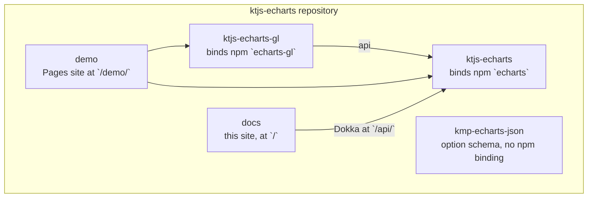
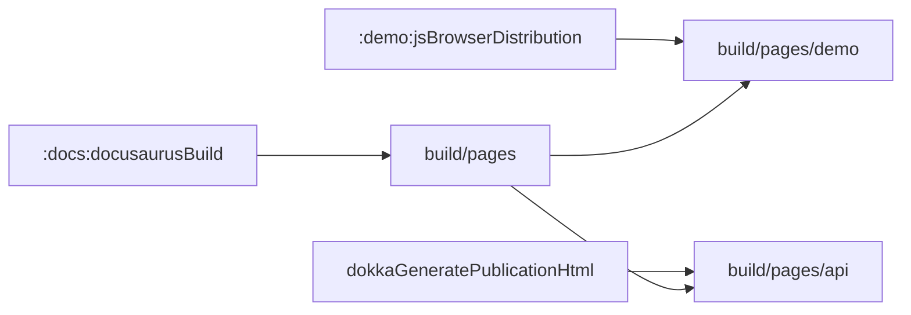

# Introduction

`ktjs-echarts` wraps the [`echarts`](https://www.npmjs.com/package/echarts) npm ecosystem for Kotlin/JS.
One Gradle module per npm package (or per group of packages that share an upstream version and release
cadence), each generating declarations from the upstream sources.

## Modules

| Module | npm package | What it gives you |
| --- | --- | --- |
| `ktjs-echarts` | `echarts` | The module-level API (`init`, `use`, `registerTheme`, `registerMap`, the `format` / `time` / `graphic` namespaces), `echarts/core` with every installer, the typed option objects and the classes extension authors extend. |
| `ktjs-echarts-gl` | `echarts-gl` | 3D and WebGL series and components: `bar3D`, `scatterGL`, `globe`, `grid3D`, the post-effect options and the GL installers. It depends on `ktjs-echarts` with `api` scope. |
| `kmp-echarts-json` | *(none)* | The same option schema as `@Serializable` Kotlin classes, common code only. It produces a JSON string; it does not touch a browser. |

## Versioning

Every module is versioned as `{upstream npm version}-kt.{revision}`:

- The upstream version is declared once in the root `package.json`; the revision is read per module from
  `wrapper-revisions.properties`.
- Only `-kt.N` versions are published. A version without the suffix never exists.
- An upstream upgrade changes the number in `package.json`; a wrapper-only fix increments the revision
  (`kt.2`, `kt.3`, ...) and leaves the base version alone.
- Revisions only increase. A release bumps and publishes only the modules that changed.

## Repository layout

| Path | What lives there |
| --- | --- |
| `ktjs-echarts/` | The wrapper of the `echarts` package. |
| `ktjs-echarts-gl/` | The wrapper of `echarts-gl`. |
| `kmp-echarts-json/` | The multiplatform option model. |
| `demo/` | The examples, ported from upstream, published under `/demo/`. |
| `docs/` | This documentation site, published at the Pages root. |
| `wrapper-revisions.properties` | Per-module `-kt.N` revision. |
| `package.json` | The upstream npm versions, shared by every module. |

## Where the site lives

`./gradlew pagesSite` assembles one Pages artifact out of three builds: the documentation at `/`, the demo
under `/demo/` and the Dokka HTML under `/api/`. The navbar's Demo and API entries are full URLs rather
than paths for that reason — they are not routes of this Docusaurus build.

