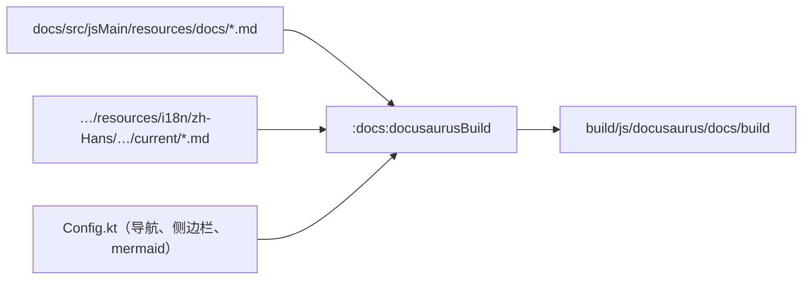

# 开发

## 环境要求

- JDK 17 或更新（构建用 Gradle 9.4.1）。
- Node.js 由 Kotlin Gradle 插件下载；`gradle.properties` 里关掉了 Yarn，所以用的是 npm。
- 首次跑浏览器测试时 Playwright 会下载 Chromium。
- 演示页的 e2e 是一个 Playwright JUnit 5 套件，所以 `node` 也要在 `PATH` 上。

## 常用命令

```bash
./gradlew build                     # 当前宿主能跑的全部
./gradlew :ktjs-echarts:jsBrowserTest
./gradlew :ktjs-echarts-gl:jsBrowserTest
./gradlew :demo:e2eTest             # 对打包后的演示页跑 Playwright
./gradlew :docs:docusaurusBuild     # 本站
./gradlew pagesSite                 # build/pages：文档在 /、演示在 /demo/、Dokka 在 /api/
```

加了或升级了 npm 依赖，要先刷新共享 lock 文件，再跑读它的构建：

```bash
./gradlew kotlinUpgradePackageLock
```

## 写文档



每一页在 `i18n/zh-Hans/docusaurus-plugin-content-docs/current/` 里都有一份同相对路径的译文。**两边一起改**：
只有一种语言有的页面会让站点自相矛盾。图用 mermaid 围栏块（` ```mermaid `），不要贴图片——主题会渲染它，
所以亮暗主题切换时它自己会跟着变。

## 发布

发布走 `.github/workflows/release.yml`：签名、按 Maven 坐标各打一个归档、注册到共享的 Maven Central hub，
由 hub 把待发布项合并成一次 Central 部署。工作树永远不是发行版：除非传 `-Pktjs.release=true`，版本都带
`-SNAPSHOT` 后缀。
