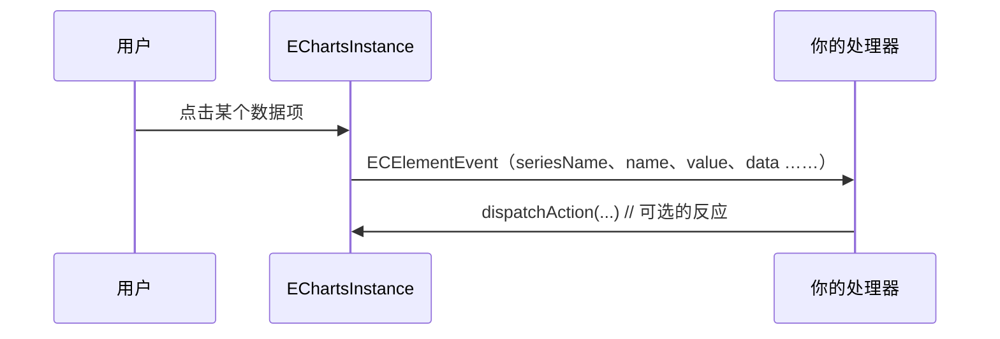

# 事件

事件名是 `EChartsEvents` 里的常量，回调收到的是类型化的负载——鼠标处理器读的字段就在事件接口上，而不在某个
`Any` 后面：

```kotlin
import io.github.shijianjs.ktjs.echarts.ECElementEvent
import io.github.shijianjs.ktjs.echarts.EChartsEvents

chart.on(EChartsEvents.Click) { event: ECElementEvent ->
    println("${event.seriesName}: ${event.name} = ${event.value}")
}
```

有四个事件的负载与鼠标事件不同，单独提供了辅助函数：

| 辅助函数 | 触发时机 |
| --- | --- |
| `onSelectChanged` | 系列的选中态变化（`selectchanged` 负载） |
| `onAxisBreakChanged` | 轴的断点被切换 |
| `onFinished` | 图表的动画结束（`finished` 负载） |
| `onRendered` | 一帧渲染完成（`rendered` 负载） |



## 派发动作

`dispatchAction(payload)` 用代码驱动图表——高亮、显示提示、选中、改数据缩放。`makeActionFromEvent(event)`
把事件负载转回同形状的动作负载，这是「重放这次交互」的写法。

## 生命周期

`on` 返回实例，可以链式注册。`off` 解绑，`dispose()` 销毁实例；被销毁的实例 `isDisposed()` 返回 `true`。
只把容器元素删掉是不够的——ECharts 自己在画布上挂着监听。
