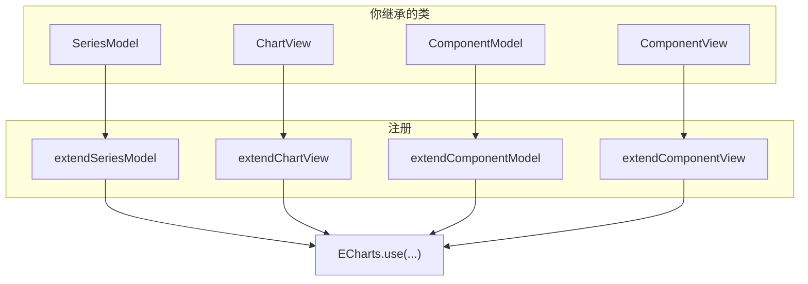

# 扩展开发

自定义系列、组件与视图，继承上游从 `echarts/core` 暴露的那些类：`Model`、`ComponentModel`、`SeriesModel`、
`ChartView`、`ComponentView`、`SeriesData`、`Axis`、`GlobalModel`、`ExtensionAPI`。注册辅助函数与上游同名：
`extendComponentModel`、`extendComponentView`、`extendSeriesModel`、`extendChartView`。

```kotlin
import io.github.shijianjs.ktjs.echarts.extendSeriesModel

val seriesModel = extendSeriesModel(js("({ type: 'mySeries' })"))
ECharts.use(seriesModel)
```



`SeriesData` 是上游 `List` 类在 Kotlin 侧的名字，在 JavaScript 边界上映射回 `List`，所以它不会和
`kotlin.collections.List` 撞名。

## 注册其他资产

模块级 API 还带着那些不是「类的扩展」的注册函数：`registerTheme`、`registerMap`、`registerLocale`、
`registerAction`、`registerCoordinateSystem`、`registerCustomSeries`、`registerLayout`、`registerVisual` 等等，
重载与上游一致。它们都挂在 `ECharts`（以及 `EChartsCore`）上，对之后创建的每个实例生效。

## 命名空间

`ECharts` 与 `EChartsCore` 暴露上游的辅助命名空间，成员在上游声明信息足够的地方都是类型化的：

| 命名空间 | 例子 |
| --- | --- |
| `format` | `formatTpl`、`addCommas`、`encodeHTML`、`truncateText` |
| `time` | `parse`、`format`、`roundTime`、`getTimezoneOffset` |
| `number` | `parsePercent`、`nice`、`linearMap`、`getPrecision` |
| `helper` | 面向扩展作者的 model 与 data 辅助 |
| 其他 | `graphic`、`color`、`matrix`、`vector`、`util`、`zrUtil`、`zrender`、`dataTool` |

上游把某个成员声明成 `any` 时，Kotlin 侧就写 `JsAny`，并在 KDoc 里说明原因——那些就是上游 `.d.ts` 里
没有任何类型信息的成员。
