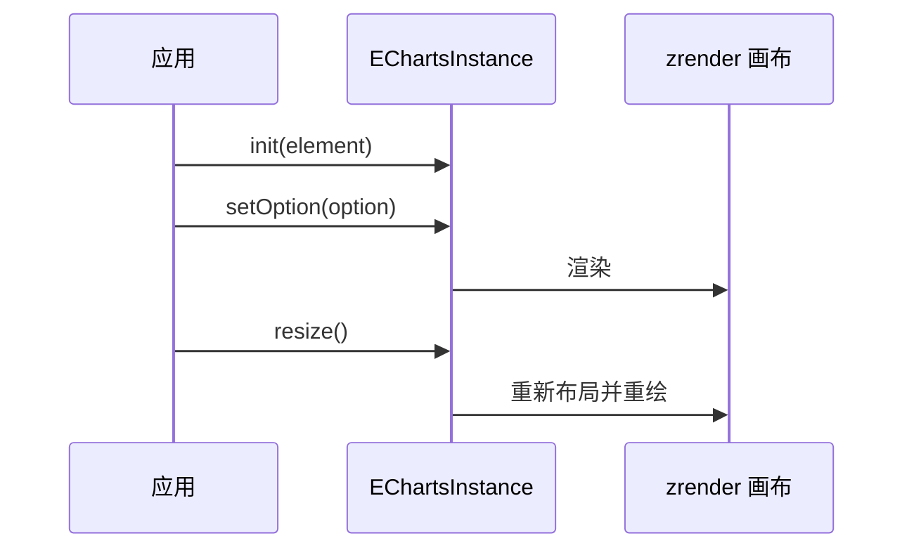

# 快速开始

## 安装

```kotlin
dependencies {
    implementation("io.github.shijianjs:ktjs-echarts:6.1.0-kt.1")
}
```

版本号换成你需要的那一个（`{上游版本}-kt.{修订号}`）。

## 第一张图

完整包已经注册了全部图表与组件，不需要再装 installer：

```kotlin
import io.github.shijianjs.ktjs.echarts.AxisTypes
import io.github.shijianjs.ktjs.echarts.ECharts
import io.github.shijianjs.ktjs.echarts.options.EChartsOption
import io.github.shijianjs.ktjs.echarts.options.XAxisOption
import io.github.shijianjs.ktjs.echarts.options.YAxisOption
import io.github.shijianjs.ktjs.echarts.options.lineSeries
import io.github.shijianjs.ktjs.echarts.options.numbers
import io.github.shijianjs.ktjs.echarts.options.one
import js.objects.unsafeJso
import web.dom.document
import web.html.HtmlTagName

val element = document.createElement(HtmlTagName.div)
document.body.append(element)

val chart = ECharts.init(element)
chart.setOption(
    unsafeJso<EChartsOption> {
        xAxis = one(unsafeJso<XAxisOption> { type = AxisTypes.category })
        yAxis = one(unsafeJso<YAxisOption> { type = AxisTypes.value })
        series = arrayOf(lineSeries { data = numbers(120.0, 200.0, 150.0) })
    },
)
```

容器本身没有固有尺寸，所以要给它一个（`style.width` / `style.height`），或者让图表跟随元素的盒子。

## 尺寸变化

ECharts 不监听容器，尺寸要自己转发：

```kotlin
import web.events.EventHandler
import web.window.window

window.onresize = EventHandler { chart.resize() }
```



## 演示与测试

```bash
# 模块级浏览器测试
./gradlew :ktjs-echarts:jsBrowserTest

# 自带演示页的 e2e（Playwright，需要 node 在 PATH 上）
./gradlew :demo:e2eTest
```

演示页是「页面怎么接这套封装」的参照：示例来自 `demo/`，跑的是已发布的模块。
