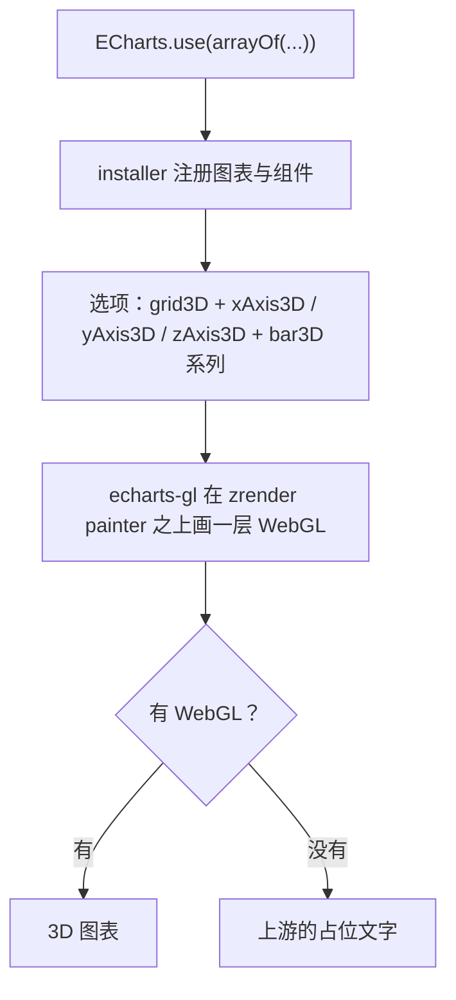

# 3D 与 WebGL

`ktjs-echarts-gl` 封装 [`echarts-gl`](https://www.npmjs.com/package/echarts-gl) 2.1，也就是给 ECharts 6 加上
3D 与 WebGL 系列的那个扩展包。`echarts-gl` 只有普通 JavaScript、没有 TypeScript 声明，所以这里的声明来自上游
源码与 `option-gl` 文档，而不是生成器。

```kotlin
dependencies {
    implementation("io.github.shijianjs:ktjs-echarts-gl:2.1.0-kt.1")
}
```

该模块用 `api` 作用域依赖 `ktjs-echarts`，核心封装会跟着来。

## 先注册，再画图

```kotlin
import io.github.shijianjs.ktjs.echarts.gl.Bar3DChart
import io.github.shijianjs.ktjs.echarts.gl.Grid3DComponent

ECharts.use(arrayOf(Bar3DChart, Grid3DComponent))
```

然后设 `grid3D` / `xAxis3D` / `yAxis3D` / `zAxis3D` 与一个 `bar3DSeries`。系列画在 canvas 之上的一层 WebGL 上：
容器要有尺寸，浏览器要有 WebGL。没有 WebGL 时，`echarts-gl` 不抛异常、不打日志，而是渲染它自己的
"Sorry, your browser does not support WebGL" 占位文字。



## Installer

图表（`echarts-gl/charts`）：

| Installer | `series.type` | 说明 |
| --- | --- | --- |
| `Bar3DChart` | `bar3D` | `grid3D`、`geo3D` 或 `globe` 上的柱子 |
| `Line3DChart` | `line3D` | 同样坐标系里的折线 |
| `Scatter3DChart` | `scatter3D` | 带符号的点 |
| `Lines3DChart` | `lines3D` | 两点之间的线，可选拖尾效果 |
| `Polygons3DChart` | `polygons3D` | `geo3D` 上挤出的多边形 |
| `SurfaceChart` | `surface` | 由 `[x, y, z]` 网格生成曲面 |
| `Map3DChart` | `map3D` | 已注册地图的区域，画在 `geo3D` / `mapbox3D` / `maptalks3D` 上 |
| `ScatterGLChart` | `scatterGL` | 面向超大数据量的 WebGL 2D 散点 |
| `GraphGLChart` | `graphGL` | 在 GPU 上布局的力导向图 |
| `FlowGLChart` | `flowGL` | 沿向量场流动的粒子 |
| `LinesGLChart` | `linesGL` | 面向大量线段的 WebGL 2D 线 |

组件（`echarts-gl/components`）：`Grid3DComponent`（`grid3D` 与 `xAxis3D` / `yAxis3D` / `zAxis3D`）、
`Geo3DComponent`（`geo3D`）、`GlobeComponent`（`globe`）、`Mapbox3DComponent`（`mapbox3D`）、
`Maptalks3DComponent`（`maptalks3D`）。Mapbox 与 maptalks 两个变体假定页面自己加载了那两个库；
`echarts-gl` 只往它们的 canvas 里画。

## 选项

`EChartsGlOption` 在核心 `EChartsOption` 之上加了 `grid3D`、`xAxis3D`、`yAxis3D`、`zAxis3D`；GL 专有的类型在
`io.github.shijianjs.ktjs.echarts.gl.options` 里：

- `Grid3DOption` —— 布局、`boxWidth` / `boxHeight` / `boxDepth`、`environment`，以及嵌套的 `viewControl`、
  `light`、`postEffect`、`temporalSuperSampling`。
- `Axis3DOption` —— 三个轴共用一个类型：范围、`name*`、分割线与分割面、轴线、刻度、标签、轴指示器。
- `ViewControlOption` —— 投影方式、相机角度与距离、自动旋转、阻尼、鼠标键绑定。
- `LightOption` —— 主光、环境光与环境 cubemap 光。
- `PostEffectOption` —— bloom、景深、SSAO、SSR、FXAA、色彩校正、描边。上游的别名 `DOF`、`SSAO`、`SSR`、
  `FXAA` 在这里叫 `dof`、`ssao`、`ssr`、`fxaa`。
- `ShadingOption` —— `shading` 与 `realisticMaterial`、`lambertMaterial`、`colorMaterial`、`hatchingMaterial`。
- 系列选项由工厂构造：`bar3DSeries { }`、`scatterGLSeries { }`、`linesGLSeries { }`、`flowGLSeries { }`、
  `graphGLSeries { }`、`polygons3DSeries { }`、`map3DSeries { }`。每个都带类型化的数据视图（`typedData`、
  `typedItemStyle`、`typedLabel`、`typedEmphasis` ……）。

枚举值同样是类型化的：`CoordinateSystems2D`、`CoordinateSystems3D`、`ShadingTypes`、`GridPlaneTypes`、
`GlBlendModes`、`ProjectionTypes`、`QualityTypes`、`AutoRotateDirections`、`MouseButtons`、
`FlowGLParticleTypes`、`GraphGLFocusNodeAdjacencyOns`、`EChartsGlSeriesTypes`。

## 为什么要引入核心模块

每个 installer 都会为副作用 `import` `echarts-gl/lib/echarts-gl.js`：那个模块注册了「更新之后把 WebGL 层插进
zrender painter」的钩子，并挂上 `echarts.graphicGL`。上游的 `sideEffects` 列表只匹配 `lib/chart` 与
`lib/component` 直接下层文件，不包括嵌套的 installer 文件，于是带 `sideEffects` 优化的打包器（webpack 默认
就是这样）会把这条 import 丢掉，图表就什么都不画。

所以读一个 installer 等于通过封装加载了核心模块，无论应用自己的 import 多精简，它都会留在包里。代价是核心
模块不可 tree-shaking——相对 claygl 与 zrender 来说，它是几 KB。
