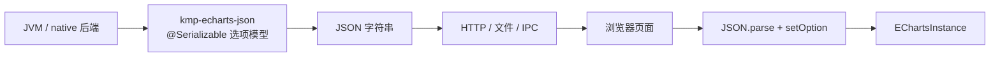

# 选项即 JSON

`kmp-echarts-json` 把 ECharts 的选项 schema 建模成 `@Serializable` Kotlin 类。它是纯 common 代码——所有声明都在
`commonMain`，不用任何 JavaScript 专有 API——目标平台是 JVM、JS（Node.js）、Wasm/JS（Node.js）、Linux x64 与
Windows x64。它只产出 JSON 字符串，把它交给 `setOption` 是别人的事。

```kotlin
dependencies {
    implementation("io.github.shijianjs:kmp-echarts-json:6.1.0-kt.1")
}
```



选项在服务端拼、或者图表由另一个进程渲染时用它。也可以和 Kotlin/JS 封装组合：一个类型化交给 `setOption` 的
对象，另一个类型化在路上传输的负载。

## 快速开始

```kotlin
import io.github.shijianjs.ktjs.echarts.json.*

val option = echartsOption {
    tooltip { trigger = TooltipTrigger.Axis }
    legend { entries("Revenue", "Cost") }
    xAxis {
        type = AxisType.Category
        categories("Jan", "Feb", "Mar")
    }
    yAxis { type = AxisType.Value }
    series {
        line {
            name = "Revenue"
            values(120, 200, 150)
            smooth = BooleanOrNumber.of(true)
        }
    }
}

val json: String = option.toJsonString(prettyPrint = true)
```

## 没设的字段就是不存在

ECharts 只对「键不存在」应用默认值，显式 `null` 与省略的键并不等价。所以每个模型字段都可空、初值为 `null`，
共用的 `Json` 实例用 `encodeDefaults = false` 加 `explicitNulls = false`：

```kotlin
echartsOption { }.toJsonString() // "{}"
```

序列化集中在 `EChartsJson`：`format`（紧凑）、`pretty`（两空格缩进）、`encodeToJsonElement(option)`（需要合并
或检查时拿到 `JsonObject`）。

## 类型化取值

ECharts 允许多种 JSON 形状的取值，用密封接口加工厂函数建模，形状在调用点就看得见：

| ECharts 取值 | Kotlin |
| --- | --- |
| `number \| string`（`min`、`max`、`left` ……） | `NumberOrString`、`num(0)`、`str("dataMax")` |
| `number \| string \| number[]`（`symbolSize`） | `NumberOrStringOrNumbers`、`of(10)`、`numbers(10, 20)` |
| `boolean \| string`（`darkMode`、`roam`） | `BooleanOrString.of(...)` |
| `boolean \| number`（`smooth`、`progressive`） | `BooleanOrNumber.of(...)` |
| `boolean \| [number, number]`（`boundaryGap`） | `BoundaryGap.of(...)` |
| 颜色、渐变、纹理 | `EChartsColor.Css`、`LinearGradient`、`RadialGradient`、`Pattern` |

`series.data` 的元素是 `DataValue`：数字、字符串、布尔、表示断点空档的 `null`、数组（点与行）以及类型化条目。
`DataItem` 覆盖带单点样式的对象形式。

`SeriesType` 是 value class，不是枚举，所以 `echarts-gl` 这类第三方系列也能写出来：

```kotlin
series {
    add(SeriesType("scatter3D")) {
        name = "3D points"
        coordinateSystem = "geo3D"
    }
}
```

`SeriesOption` 是一个扁平类，装着所有系列族的可选字段。ECharts 会忽略与所选 `type` 无关的字段；一个类既让模型
好维护，又不放弃对每个取值的类型检查。

## 时间值

模块是多平台的，所以日期时间要显式转换。`time` 轴接受 epoch 毫秒，或 ECharts 能解析的字符串形式：

```kotlin
DataValue.InstantValue(Instant.fromEpochMilliseconds(1_700_000_000_000)) // epoch 毫秒
LocalDateTime.parse("2024-04-05T06:07:08").asDataValue() // "2024-04-05 06:07:08"
LocalDate.parse("2024-04-05").asDataValue()              // "2024-04-05"
```

## 逃生口

还没建模的选项，用 `JsonElement` 辅助把原始 JSON 合进结果：`extra` 用于顶层键（在类型化键之后应用，冲突时它赢），
另有 `with(key, value)`、`plus`、`deepMerge`、`toJsonElement()`、`prettyPrint()`、`toEChartsJsonString(...)`
用于任意层级。

## 测试

```bash
./gradlew :kmp-echarts-json:build          # 当前宿主能跑的全部目标
./gradlew :kmp-echarts-json:jvmTest
./gradlew :kmp-echarts-json:jsNodeTest
./gradlew :kmp-echarts-json:wasmJsNodeTest
./gradlew :kmp-echarts-json:mingwX64Test
```

测试在 `src/commonTest`，在每个目标上跑的是同一份。
