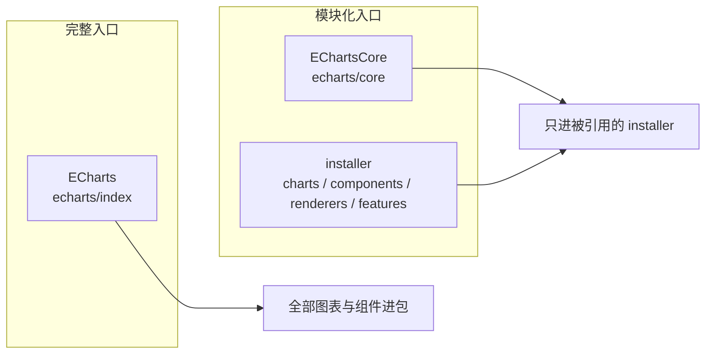

# 模块化构建

`EChartsCore` 就是 `echarts/core` 入口。只注册页面用得上的图表、组件、渲染器与特性，再从 `EChartsCore` 初始化：

```kotlin
import io.github.shijianjs.ktjs.echarts.EChartsCharts
import io.github.shijianjs.ktjs.echarts.EChartsComponents
import io.github.shijianjs.ktjs.echarts.EChartsCore
import io.github.shijianjs.ktjs.echarts.EChartsRenderers

EChartsCore.use(
    arrayOf(
        EChartsCharts.LineChart,
        EChartsComponents.GridComponent,
        EChartsComponents.TooltipComponent,
        EChartsRenderers.SVGRenderer,
    ),
)

val chart = EChartsCore.init(element)
```

installer 是四个对象上的属性：`EChartsCharts`、`EChartsComponents`、`EChartsRenderers`、`EChartsFeatures`。
渲染器是初始化参数：

```kotlin
val chart = EChartsCore.init(
    element,
    null,
    unsafeJso<EChartsInitOpts> { renderer = RendererTypes.svg },
)
```

## 什么时候还算模块化

打包后是否模块化，只取决于你引用了什么：



`EChartsCore` 与完整的 `ECharts` 是两个独立的 `@JsModule` 声明，所以只用前者不会把完整构建拉进来；但只要包里
任何一处引用了 `ECharts`，它就会被拉进来。所以在模块化路径上，注册**和**辅助命名空间都要用 `EChartsCore`。

两个入口产出的都是 `EChartsInstance`，所以通过 `EChartsCore` 创建的实例可以传给任何接受该共享类型的辅助函数。

## 与 echarts-gl 的关系

`ktjs-echarts-gl` 内部依赖完整的 `echarts` 构建（原因见 [3D 与 WebGL](gl.md)），所以画 GL 系列的页面没法同时
声称自己是模块化打包。二选一：GL 系列，还是手挑的 installer 列表。
