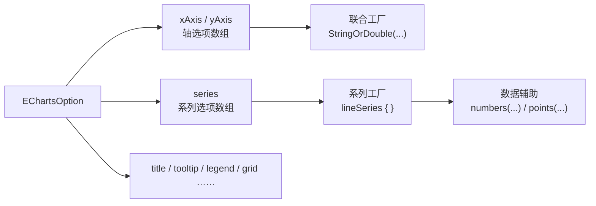

# 选项

选项就是一个普通 JavaScript 对象，所以建模成 `external interface`，字段是可空的 `var`。用
kotlin-js-plain-objects 的 `js.objects.unsafeJso<T> { ... }` 构造：它生成真正的对象字面量，并执行接收者块。
没赋过的字段保持 ECharts 默认值——赋 `null` 会真的写入 `null`，两者并不等价。

```kotlin
val title = unsafeJso<TitleOption> {
    text = "Monthly revenue"
    subtext = "In thousands"
}
```

## 用类型代替字符串

上游声明了大量字符串枚举。这里每个都是 `sealed external interface` 加一个常量对象，拼错就是编译错误，
而不是 ECharts 默默忽略的选项：

| 常量对象 | 覆盖 |
| --- | --- |
| `AxisTypes` | `category`、`value`、`time`、`log` |
| `SeriesTypes` | 内置系列类型，含 GL 的 |
| `TooltipTriggers` | `item`、`axis`、`none` |
| `LegendTypes` | `plain`、`scroll` |
| `AxisPointerTypes` | `line`、`shadow`、`cross`、`none` |
| `ImageTypes` | `png`、`jpeg`、`svg` |
| `AnimationEasings` | 缓动名 |
| `RendererTypes`（`io.github.shijianjs.ktjs.zrender`） | `canvas`、`svg` |

要 CSS 值的字段用 kotlin-wrappers 的类型——`web.cssom.FontStyle`、`FontWeight`、`TextAlign`、
`VerticalAlign`——以及 canvas 的 line cap / join 类型。

## 联合类型

上游写 `A | B` 的地方，封装用不透明接口加成员工厂。显式的包装正是让联合保持类型化、而不是退回
`dynamic` 的原因：

```kotlin
StringOrDouble("40%")     // 字符串分支
StringOrDouble(24.0)      // 数字分支
BooleanOrDouble(true)
DoubleOrDoubleArray(arrayOf(4.0, 8.0))
```

## 辅助函数

`io.github.shijianjs.ktjs.echarts.options` 里是让选项读得下去的辅助函数：

| 辅助 | 为什么存在 |
| --- | --- |
| `one(value)` | 既能接一个组件又接列表的字段，在 Kotlin 侧统一是数组；`one` 覆盖「只有一个」这个常见情形。 |
| `numbers(...)`、`points(...)`、`items(...)` | 构造真正的 JavaScript 数组。Kotlin 的 `DoubleArray` 是定型数组，ECharts 不接受它作系列数据。 |
| `lineSeries { }`、`barSeries { }`、`pieSeries { }` …… | 生成一个已经把 `type` 设好的系列对象。 |
| `linearGradient(...)`、`radialGradient(...)`、`gradientColorStop(...)` | 渐变色，色标是类型化条目。 |



## 系列数据

`series.data` 接受数字、点、行与类型化条目。`numbers(...)`、`points(...)`、`items(...)` 覆盖三种常见形状；
其余用对应 `*DataItem` 类型的 `unsafeJso` 条目构造。
