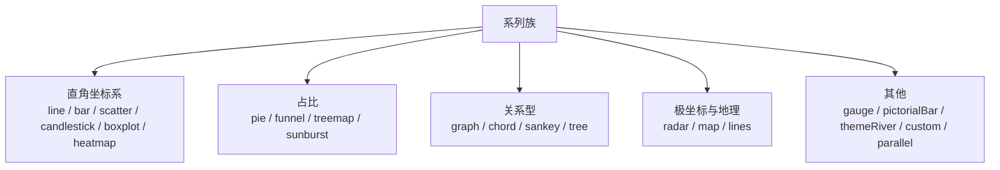

# 系列与图表

内置的每个系列族都有一个工厂函数，它替你设好 `type`。工厂的接收者就是该族的系列选项类型，所以里面的字段
就是上游为这一族声明的那些：

```kotlin
series = arrayOf(
    lineSeries {
        name = "Revenue"
        smooth = BooleanOrDouble(true)
        data = numbers(120.0, 200.0, 150.0)
    },
    barSeries {
        name = "Cost"
        data = numbers(90.0, 140.0, 130.0)
    },
)
```

覆盖了 `line`、`bar`、`pie`、`scatter`、`effectScatter`、`radar`、`map`、`tree`、`treemap`、`sunburst`、
`graph`、`chord`、`funnel`、`gauge`、`pictorialBar`、`themeRiver`、`custom`、`boxplot`、`candlestick`、
`heatmap`、`parallel`、`lines`、`sankey`。3D 与 WebGL 系列在 `ktjs-echarts-gl` 里，形状一致
（`bar3DSeries`、`scatterGLSeries` ……）。



## 坐标系由谁决定

系列类型不决定版式：`xAxis` / `yAxis` 决定折线是否走直角坐标系，`polar` 加 `angleAxis` / `radiusAxis` 让它
走极坐标，`calendar`、`singleAxis`、`geo` 则是各自独立的坐标系。声明了用不上的 `coordinateSystem` 的系列
直接不渲染，控制台里也不报——所以图是空白时，先查坐标系再看数据。

## 数据形状

| 形状 | 辅助函数 | 上游类型 |
| --- | --- | --- |
| `[120, 200, 150]` | `numbers(...)` | `Array<Double>` |
| `[[1, 2], [2, 3]]` | `points(...)` | `Array<Array<Double>>` |
| `[{ name = "A", value = 3.0 }]` | `items(...)` | `Array<DataItemOption>` |

`dataset` / `heatmap` 的行数据、`tree` / `treemap` / `sunburst` 的层级节点，由各自的 `*DataItem` 接口类型化，
用该类型的 `unsafeJso` 构造。

## 系列旁边的组件

选项其余顶层键就是组件：`title`、`tooltip`、`legend`、`grid`、`xAxis`、`yAxis`、`polar`、`radar`、`dataZoom`、
`visualMap`、`toolbox`、`dataset`、`timeline`、`graphic`、`aria`。既接单个组件又接数组的字段，在 Kotlin 侧
统一是数组，所以只有一个组件时要写 `one(...)`——这是为了让「多个组件」不需要第二种类型。
