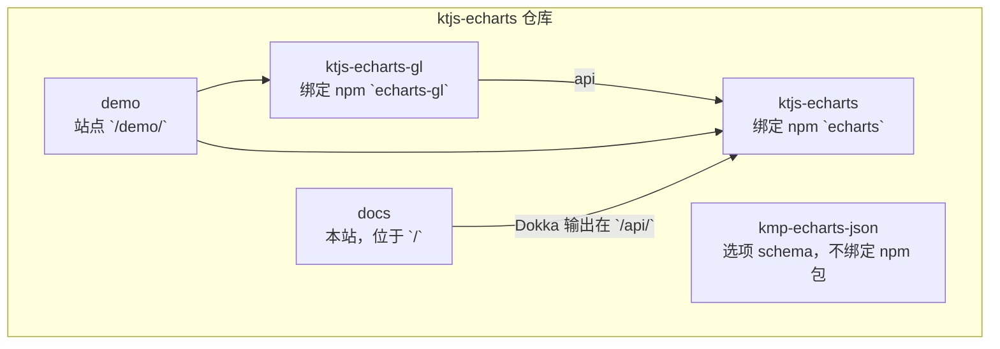
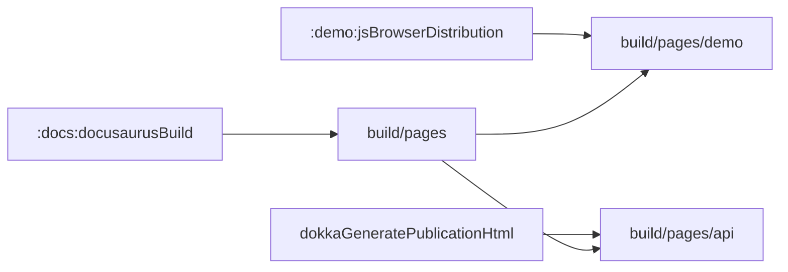

# 简介

`ktjs-echarts` 把 [`echarts`](https://www.npmjs.com/package/echarts) npm 生态封装成 Kotlin/JS 可用的形式。
一个 npm 包（或一组共享上游版本与发布节奏的包）对应一个 Gradle 模块，声明从上游源码生成。

## 模块

| 模块 | npm 包 | 提供什么 |
| --- | --- | --- |
| `ktjs-echarts` | `echarts` | 模块级 API（`init`、`use`、`registerTheme`、`registerMap`，`format` / `time` / `graphic` 命名空间）、`echarts/core` 及其全部 installer、类型化选项对象，以及扩展作者需要继承的类。 |
| `ktjs-echarts-gl` | `echarts-gl` | 3D 与 WebGL 系列与组件：`bar3D`、`scatterGL`、`globe`、`grid3D`、后处理选项与 GL installer。它用 `api` 作用域依赖 `ktjs-echarts`。 |
| `kmp-echarts-json` | *（无）* | 把同一套选项 schema 建模成 `@Serializable` 类，纯 common 代码，产出 JSON 字符串，不碰浏览器。 |

## 版本口径

每个模块的版本都是 `{上游 npm 版本}-kt.{修订号}`：

- 上游版本在根 `package.json` 里声明一次，修订号按模块从 `wrapper-revisions.properties` 读取。
- 只有带 `-kt.N` 的版本会被发布，不带后缀的版本从未存在。
- 上游升级改 `package.json` 里的数字；仅封装侧修复时修订号加一（`kt.2`、`kt.3` ……），基础版本不动。
- 修订号只增不减。发布只升版并上传有改动的模块。

## 仓库结构

| 路径 | 内容 |
| --- | --- |
| `ktjs-echarts/` | `echarts` 包的封装。 |
| `ktjs-echarts-gl/` | `echarts-gl` 的封装。 |
| `kmp-echarts-json/` | 多平台选项模型。 |
| `demo/` | 从上游移植的示例，发布到 `/demo/`。 |
| `docs/` | 本站源码，发布到 Pages 根。 |
| `wrapper-revisions.properties` | 各模块的 `-kt.N` 修订号。 |
| `package.json` | 全模块共享的上游 npm 版本。 |

## 站点布局

`./gradlew pagesSite` 把三份产物拼成一个 Pages 目录：文档在 `/`，演示在 `/demo/`，Dokka 在 `/api/`。
导航栏的「演示」「API」因此写的是完整 URL 而不是路径——它们不是这个 Docusaurus 站点的路由。

